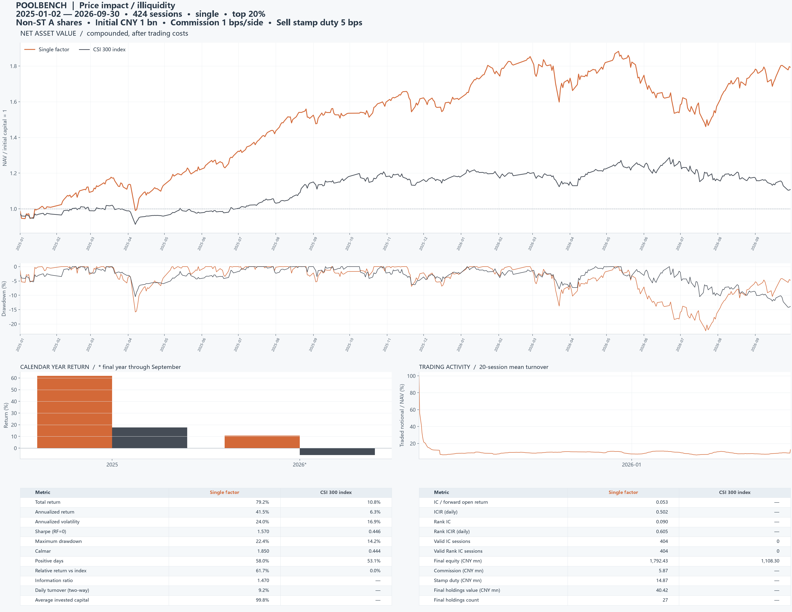
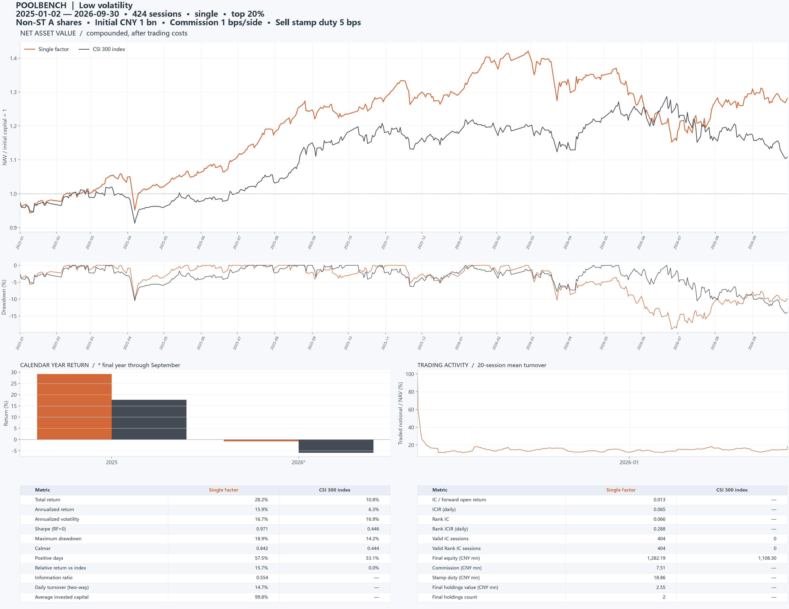
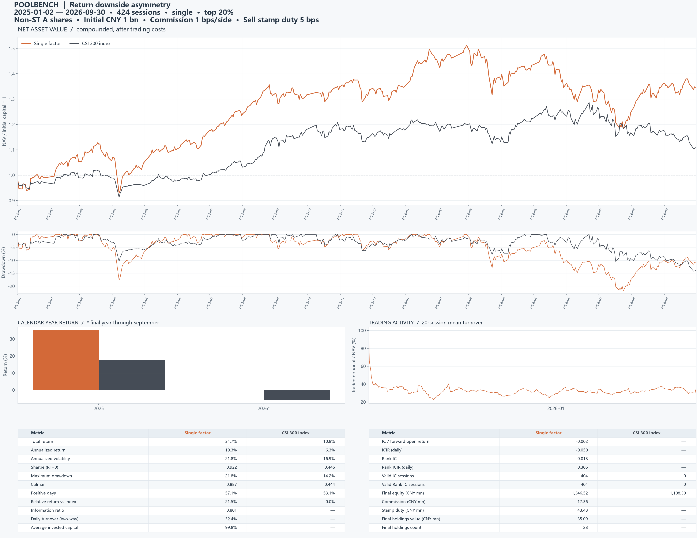
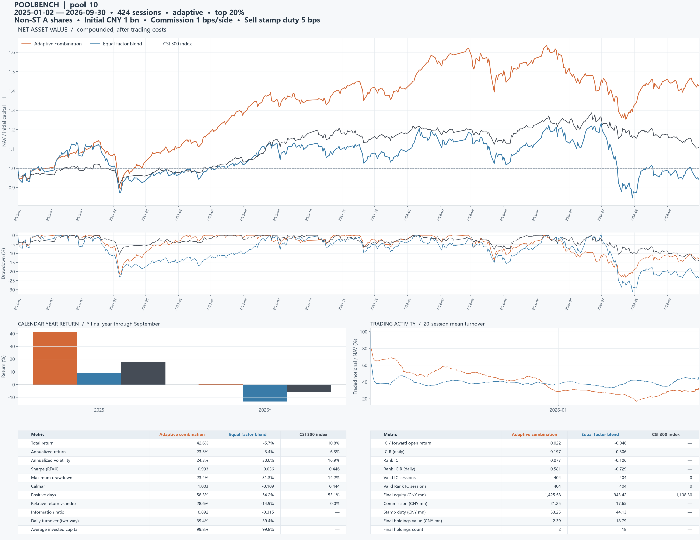
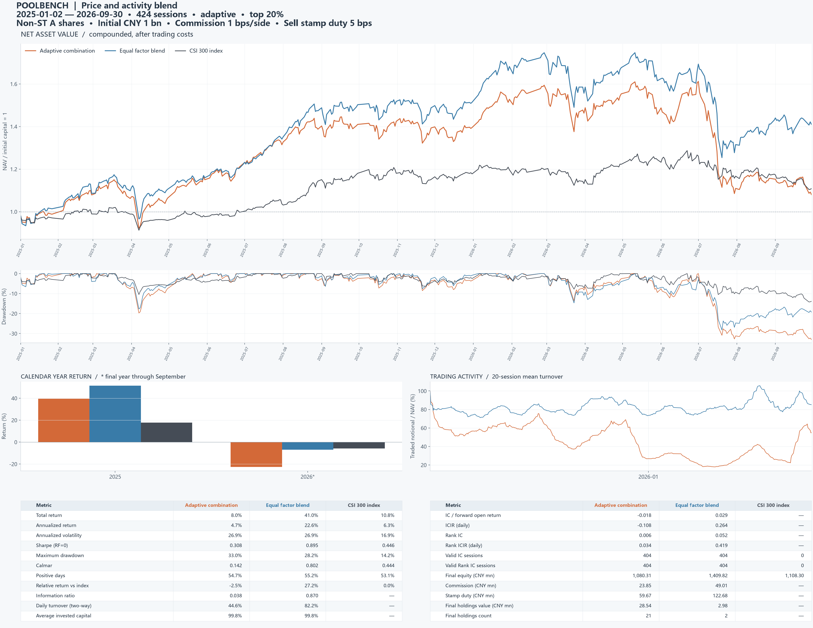

# Backtest System for Quantitative Researchers

把你的策略因子表示成一个 `pool.json`，运行回测，变成一份 A 股因子回测报告。适合每天提出因子、需要快速验证以及比较多因子组合方法的策略研究者。

支持单因子、滚动多因子组合、固定权重与因子等权对照。沪深 300 价格指数为 baseline，净值、回撤、年度收益、换手和指标同图展示。

## 结果展示

统一口径：2025-01-02 至 2026-09-30，424 个交易日，初始 10 亿元；买卖各万一佣金，卖出万五印花税。同期沪深 300 累计收益 **10.83%**。

| 策略 | 指标对应曲线 | 累计净收益 | 年化收益 | Sharpe | 最大回撤 | 文件 |
|---|---|---:|---:|---:|---:|---|
| 非流动性 | 单因子 | 79.24% | 41.46% | 1.570 | 22.41% | [报告](showcase/illiquidity/report.png) · [pool](showcase/illiquidity/pool.json) · [指标](showcase/illiquidity/metrics.json) |
| 低波动 | 单因子 | 28.22% | 15.92% | 0.971 | 18.90% | [报告](showcase/low_volatility/report.png) · [pool](showcase/low_volatility/pool.json) · [指标](showcase/low_volatility/metrics.json) |
| 收益偏度 | 单因子 | 34.65% | 19.34% | 0.922 | 21.82% | [报告](showcase/downside_asymmetry/report.png) · [pool](showcase/downside_asymmetry/pool.json) · [指标](showcase/downside_asymmetry/metrics.json) |
| 50因子组合 pool_9999 | 滚动组合 | 58.50% | 31.49% | 1.273 | 20.06% | [报告](showcase/pool_9999/report.png) · [pool](showcase/pool_9999/pool.json) · [指标](showcase/pool_9999/metrics.json) |
| 50因子组合 pool_10 | 滚动组合 | 42.56% | 23.46% | 0.993 | 23.39% | [报告](showcase/pool_10/report.png) · [pool](showcase/pool_10/pool.json) · [指标](showcase/pool_10/metrics.json) |
| 六因子组合 | 因子等权 | 40.98% | 22.65% | 0.895 | 28.23% | [报告](showcase/classic/report.png) · [pool](showcase/classic/pool.json) · [指标](showcase/classic/metrics.json) |

单因子按已完成实验的 Sharpe 选取前三项；多因子表格注明指标对应的曲线，每份报告均保留滚动组合、因子等权和指数对照。[全部 13 组实验指标](showcase/all_experiments.csv) · [完整结果文件](showcase/README.md)。

### 非流动性单因子



### 50 因子滚动组合


<details>
<summary>查看其余策略图表</summary>

#### 低波动



#### 收益偏度



#### 50因子组合 pool_10



#### 六因子组合



</details>

## 回测设置

| 项目 | 设置 |
|---|---|
| 股票范围 | 提供数据中的全市场股票，按历史每日 ST 和交易状态动态筛选非 ST 股票 |
| 初始资金 | 10 亿元人民币 |
| 佣金 | 买入、卖出各万一 |
| 印花税 | 卖出金额的万五 |
| 评价区间 | 2025 年首个交易日至 2026 年 9 月最后交易日 |
| 历史窗口 | 2020 年起的数据用于指标预热和滚动训练，不计入评价收益 |
| 交易时序 | 收盘生成信号，次日开盘调仓，收盘记账，末日停止新开仓并按收盘价平仓 |
| 指数基准 | 真实沪深 300 价格指数 |

## 开始使用

在项目目录运行，推荐 Python 3.11：

```powershell
uv sync --extra dev
uv run python run_adaptive_combination.py factors/single_factor/low_volatility.json
uv run python run_adaptive_combination.py factors/multi_classic.json
```

也可以运行 `uv run poolbench my_pool.json` 或 `uv run python -m quantbt my_pool.json`。不使用 uv 时，先 `pip install -e ".[dev]"`，再用 Python 运行同一入口。

将[课程数据](https://github.com/aslan9/pku_quantllm/releases/download/data-backtest-20261016/feathers.zip)中的七个 Feather 文件放入 `feathers/`。行情覆盖 2020—2026 年 10 月；历史 ST/交易状态位于 `market_status/state.feather`，指数位于 `benchmarks/csi300.csv`。回测完全离线，原始行情不重复上传。

结果写入 `results/<pool名>_<运行时间>/`，打开 `report.png` 查看同图报告，`report.svg` 可无损放大。

## 只写 pool.json

单因子示例，分数越高越优先买入：

```json
{
  "name": "五日反转",
  "exprs": ["Mul(-1,TsPctChange($close,6))"]
}
```

多因子只需增加表达式：

```json
{
  "name": "价格组合",
  "exprs": [
    "Mul(-1,TsPctChange($close,6))",
    "TsPctChange($close,61)",
    "Mul(-1,TsStd(TsPctChange($close,2),20))"
  ]
}
```

`expr` 旧键和单个字符串也兼容。`TsPctChange(x,n)` 使用 n 个观测的首尾变化，因此五日收益率写作 `TsPctChange(x,6)`。[完整算子手册](docs/operators.md)定义了全部 38 个算子。

参数可以写入 `backtest`，命令行同名参数优先：

```json
{
  "exprs": ["Mul(-1,TsStd(TsPctChange($close,2),20))"],
  "backtest": {"top_fraction": 0.1, "refit_every": 20}
}
```

常用命令：

```powershell
uv run poolbench factors/multi_classic.json --check
uv run poolbench factors/multi_classic.json --output results/my_experiment
uv run poolbench factors/multi_classic.json --method equal
uv run poolbench factors/multi_classic.json --refit-every 5 --window 252
uv run poolbench factors/multi_classic.json --strict-features
```

固定权重模式：pool 加入 `"weights": [0.5,-0.2,0.3]`，使用 `--method fixed`。权重是因子评分系数，按绝对值之和归一化；股票资金权重仍由选股规则生成。

## 回测如何工作

### 股票范围与特征

每天仅使用历史 `isST=0`、交易状态正常、有效收盘价格和成交额大于零的证券；默认至少累计 60 个有效价格观测。状态未知的证券不进入选股。新变为 ST 的持仓按调仓规则退出，停牌时暂停成交。

每个因子在当日合格股票截面上做总体标准差的 z-score，截断到 `[-5,5]`。计算只使用当日及之前数据。缺失因子在合成中贡献零，所有活跃因子都缺失的股票不参与排名；常量截面不产生交易信号。

| 字段 | 定义 |
|---|---|
| `$open/$high/$low/$close` | 原价格乘以相对累计复权因子 |
| `$amt` | 原成交额，人民币元 |
| `$num_trades` | 原成交笔数 |
| `$cumadj` | 原累计复权因子 |
| `$vwap` | 价格代理：复权 OHLC4 |
| `$volume` | 估计成交量：原成交额/原 OHLC4 |

`--strict-features` 只接受原始已有字段，拒绝最后两种代理。滚动统计要求完整有效窗口；引用、差分和涨跌幅检查实际引用端点。无定义运算保留为缺失值。

### 滚动组合

单因子默认直接按表达式方向执行。多个因子默认执行以下过程：

1. 每 20 个交易日更新一次权重，历史窗口为最近 252 个可用标签起点日。
2. 信号日 t 的监督标签为 `open[t+1+h]/open[t+1]-1`，默认 h=20。训练日只使用退出日已经到达的标签。
3. 计算历史平均 Rank IC 和日度 Rank ICIR，按绝对 Rank ICIR 排序，最多取 10 个因子。
4. 对日期×股票样本做带截距的岭回归，惩罚系数默认 0.001；系数可以为负。
5. 中间交易日沿用系数，对新的因子截面评分。历史不足时使用等权系数，记录在 `weights.csv`。

多因子报告自动包含 `Equal factor blend`：全部输入因子标准化后按 `1/K` 合成，再独立选股和记账。它不是单因子净值的平均，也不是只等权自适应选中的因子。自适应组合与等权组合共用股票范围、账户和费用设置。

### 持仓、资金与费用

默认买入分数最高的前 20% 股票，目标等资金权重。账户以人民币记录现金与资产，持仓使用复权份额记账。每天先卖出、再按可用现金买入，初始建仓、日常调仓和末日退出均计费：

```text
佣金 = (买入成交额 + 卖出成交额) × 0.0001
印花税 = 卖出成交额 × 0.0005
资产 = 现金 + 持仓市值
净值 = 资产 / 1,000,000,000
```

采用开盘价撮合的日频研究口径。末日不再新开仓，在收盘执行退出；无法成交的持仓保留在账户并单独列示。无有效价格时使用最近已知价格估值。

### 指标

净值采用 `cumprod(1+r)`。年化按 252 个交易日；波动率使用样本标准差。最大回撤包含初始资本 1；Sharpe 的无风险利率为零。报告同时给出总收益、年化收益、波动率、Sharpe、Calmar、正收益天数比例、相对指数收益、信息比率、平均换手、平均仓位和人民币费用。

IC/Rank IC 分别是每日因子分数与 h 日远期开盘收益的截面 Pearson/Spearman 相关，至少三只有效股票，并列用平均秩。ICIR 为有效日相关系数的均值/样本标准差，不年化。末尾尚未兑现的标签不参与 IC 统计。

## 输出文件

| 文件 | 内容 |
|---|---|
| `report.png` / `report.svg` | 净值、回撤、年度收益、换手、指标和人民币费用同图展示；横轴逐月标注年-月 |
| `metrics.json` / `metrics.csv` | 汇总指标、期末资产/现金/持仓、累计佣金与印花税 |
| `daily.csv` | 每日收益、净值、资产、现金、持仓市值、成交额、分项费用与交易状态统计 |
| `annual_returns.csv` | 自然年区间收益 |
| `ic.csv` | 按信号日记录的 IC/Rank IC |
| `factors.csv` | 表达式、字段、回溯长度、覆盖与单因子评价 |
| `weights.csv` | 更新日期、训练首尾、标签兑现日、样本数和回归系数 |
| `pool.json` / `manifest.json` | 生效配置、输入和代码哈希、软件版本及运行信息 |

`f000` 等编号对应 `exprs` 顺序。未定义指标在 JSON 中为 `null`。所有历史实验默认使用新目录，不覆盖旧结果。

## 参数

| pool 中的键 | 默认值 | 用途 |
|---|---:|---|
| `method` | `auto` | 单因子直接执行，多因子自适应；另支持 `equal/fixed/adaptive` |
| `initial_cash` | 1000000000 | 初始人民币资金 |
| `commission_bps` | 1 | 买卖每侧佣金，基点 |
| `stamp_duty_bps` | 5 | 卖出印花税，基点 |
| `liquidate_at_end` | true | 末日收盘退出 |
| `window` / `refit_every` | 252 / 20 | 训练窗口与系数更新间隔 |
| `label_days` / `min_train_days` | 20 / 60 | 标签跨度与最少历史日数 |
| `n_factors` | 10 | 最多选中因子数 |
| `threshold_ric` / `threshold_ricir` | 0.015 / 0.15 | 历史筛选阈值 |
| `ridge_alpha` | 0.001 | 岭回归惩罚系数 |
| `top_fraction` / `min_listing_days` | 0.2 / 60 | 选股比例与最少有效价格观测 |
| `strict_features` | false | 禁止代理字段 |

命令行将下划线替换为连字符；完整选项见 `uv run poolbench --help`。

## 模块与维护

```text
pool → config → data + expressions → combine → portfolio → metrics + report
```

| 模块 | 职责 |
|---|---|
| `config.py` | 参数、pool 兼容与固定日期 |
| `data.py` | 行情、历史 ST/交易状态、复权和标签 |
| `expressions.py` | 安全解析与数值算子 |
| `combine.py` | 成熟标签、历史筛选、岭回归和基线 |
| `portfolio.py` | 人民币账户、交易、费用和退出 |
| `metrics.py` / `report.py` | 统计指标和合并大图 |
| `runner.py` | 串联流程并保存实验 |

五个运行依赖，无数据库、服务或 GPU。因子矩阵采用临时 memmap，回归分块累计统计量；版本由 `uv.lock` 固定。新增算子同时补充手册、数值测试和历史前缀不变性测试。

```powershell
uv run pytest -q
```

[算子手册](docs/operators.md) · [代码来源](docs/provenance.md) · [验证记录](docs/validation.md)

需要更新状态或指数时：

```powershell
uv sync --extra dev --extra download
uv run python scripts/download_status.py
uv run python scripts/download_benchmark.py
```

状态来源为 [BaoStock 历史 isST/tradestatus](https://pypi.org/project/baostock/)，旁边的 `.source.json` 记录日期、编码和哈希。`--data/--status/--benchmark` 可以分别指定行情、状态和指数文件。
