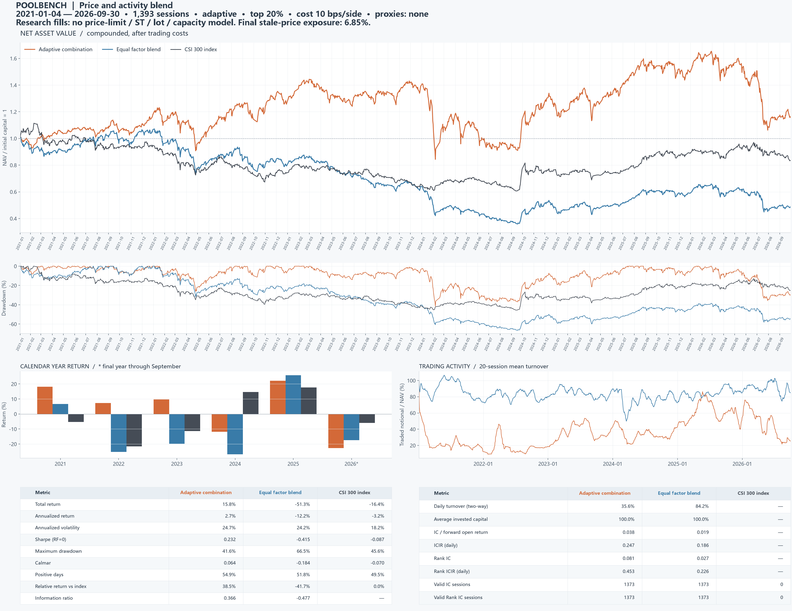

# 实际验证记录

验证日期：2026-10-16。环境：Windows、Python 3.11，依赖见 `uv.lock`。

## 自动化测试

`uv run pytest -q`：77 项通过。测试不需要私人股票数据。覆盖：

- 全部 38 个算子的前缀不变性；主要时序公式的 NumPy 手算对照；并列秩与无定义数学运算。
- 拒绝未来 Ref、不安全表达式和错误配置；固定/等权组合口径。
- 极小/极大量纲的标准化不变性；共线性回归保留全部样本。
- 成熟标签边界；尚未成熟标签与未来 IC 被扰动后历史拟合权重不变。
- 费用与现金守恒；缺失卖出价冻结；同日未来收盘价不改变开盘选股。
- 复利净值与包含初始资本的回撤；指数日历完整性。
- 结束日后股票价格与复权数据被极端修改后，历史特征不变；数据轴不匹配报错；数据对象释放后缓存可回收。

## 提供的数据全区间验收

全部 13 个 pool 完成 5,451 只股票、2021-01-04 至 2026-09-30 的 1,393 个交易日回测。三份原始 pool 未改写。其余为新增九个单因子和一个六因子组合。

| 本地结果目录（位于 results/） | 因子数 | 策略累计净收益 | 因子等权累计净收益 | 本机耗时 |
|---|---:|---:|---:|---:|
| `verified_classic` | 6 | 15.75% | -51.31% | 75.8s |
| `verified_downside_asymmetry` | 1 | 46.39% | — | 26.6s |
| `verified_gap_reversal` | 1 | -89.69% | — | 23.5s |
| `verified_illiquidity` | 1 | 192.45% | — | 23.6s |
| `verified_intraday_reversal` | 1 | -74.02% | — | 21.8s |
| `verified_low_volatility` | 1 | 80.10% | — | 22.2s |
| `verified_momentum_60d` | 1 | -51.34% | — | 22.5s |
| `verified_pool_10` | 50 | 68.64% | -73.74% | 384.0s |
| `verified_pool_9999` | 50 | 82.91% | -34.07% | 415.7s |
| `verified_range_position` | 1 | -78.17% | — | 23.3s |
| `verified_reversal_5d` | 1 | -43.78% | — | 22.8s |
| `verified_single_pool_1` | 1 | -47.45% | — | 25.4s |
| `verified_trade_size` | 1 | -14.22% | — | 22.9s |

相同期间沪深 300 价格指数累计收益为 -16.41%。耗时是开发机实测，部分任务同时运行，不是性能承诺。

对每个结果再次核验了以下恒等式与约束：

- 每日收益复利可重建导出的每一条净值曲线，误差小于 1e-11 相对容差。
- 期末净值与 metrics 中累计收益一致。
- 日期、交易日数和固定评价区间一致，所有净值有限。
- 策略仓位在 [0,1]、换手非负；训练记录中最后标签兑现日不晚于信号日。
- 11 类预期输出文件齐全；指数在所有报告中一致。

`--strict-features` 对原始 `$vwap` 单因子按预期退出，状态码为 2；不含代理字段的六因子池通过严格检查。全部 38 个算子都在算子手册中有定义。

## 图表核验

已打开检查单因子和多因子合并大图：逐月年-月刻度、三条曲线的图例/配色、回撤、年收益、换手及指标表均可读。下方为六因子示例：

## 解释边界

上述数字用于验证系统能运行和基线口径正确，没有据此筛选或优化示例。原池的生成过程未做独立样本外审计。部分原始表达式使用 OHLC4/估计成交量代理；这些不是原 VWAP/volume 的等价评价。

实际数据存在后续缺少价格的持仓：例如六因子自适应组合期末陈旧估值暴露约 6.85%；原 pool_10 自适应约 2.92%，原 pool_9999 自适应约 2.66%。没有退市清算或恢复交易数据，不能把冻结估值视为已实现可回收资金。

成交仍是简化开盘价假设；没有 ST/涨跌停/容量/整手约束。研究边界与完整公式见 README。完整私有原始数据和本地实验目录均不进入 GitHub；代码仓库只附这一张示例图与本验证记录。
